# Bug report EShop – kết quả đã đối soát

Sinh viên: Võ Hữu Thắng — 23120355. Cập nhật 11/11/2026.

**18 bug xác nhận**, gồm 17 mục checklist Failed và BUG-16 bổ sung từ luồng ProductDetail. **5 nhận xét UX** được ghi riêng. 22 mục Failed không đồng nghĩa 22 bug duy nhất.

Nguồn kỳ vọng: [đặc tả SUT](https://github.com/ttbhanh/eshop-sut/blob/85af3ba875c88283615e22cb108f13e2fccaf0e9/README.md), không chỉ mã implementation. Chrome 157.0.8103.39 / Windows 10.0.26200; Playwright gọi backend thật, fixture tổng hợp riêng. Mobile: Galaxy A52 SM-A525F/DS, ảnh người dùng cung cấp; phiên bản Android/Expo Go chưa cung cấp.

| Mã | Lỗi | Mức độ | Checklist | GitHub |
| --- | --- | --- | --- | --- |
| BUG-01 | Checkout dùng VND trong nhãn thay vì thống nhất ₫ | Minor | CHK-IA01-01 | [Issue](https://github.com/vhthawng/software-testing-hw03/issues/8) |
| BUG-03 | Profile từ chối số điện thoại hợp lệ bắt đầu bằng 0 | Major | CHK-IA02-01 | [Issue](https://github.com/vhthawng/software-testing-hw03/issues/1) |
| BUG-04 | Checkout cho sửa trực tiếp tổng tiền thanh toán | Major | CHK-IA02-02 | [Issue](https://github.com/vhthawng/software-testing-hw03/issues/2) |
| BUG-05 | Admin lưu sản phẩm có giá 0 hoặc âm | Major | CHK-IA02-04 | [Issue](https://github.com/vhthawng/software-testing-hw03/issues/9) |
| BUG-06 | Đăng ký native mobile thiếu Xác nhận mật khẩu | Major | CHK-IA02-05 | [Issue](https://github.com/vhthawng/software-testing-hw03/issues/7) |
| BUG-07 | Click label Số điện thoại không focus input Profile | Minor | CHK-IA02-07 | [Issue](https://github.com/vhthawng/software-testing-hw03/issues/10) |
| BUG-08 | Cart không có điều khiển chỉnh số lượng | Major | CHK-IA02-10 | [Issue](https://github.com/vhthawng/software-testing-hw03/issues/5) |
| BUG-09 | Admin nhận và lưu tên sản phẩm dài 256 ký tự | Minor | CHK-IA02-14 | [Issue](https://github.com/vhthawng/software-testing-hw03/issues/11) |
| BUG-10 | Header web không có badge số lượng giỏ hàng | Minor | CHK-IA03-01 | [Issue](https://github.com/vhthawng/software-testing-hw03/issues/12) |
| BUG-11 | Header web không đánh dấu trang đang chọn | Minor | CHK-IA03-06 | [Issue](https://github.com/vhthawng/software-testing-hw03/issues/13) |
| BUG-13 | Sửa một sản phẩm làm đổi tên toàn bộ bảng Admin trên UI | Major | CHK-IA04-02 | [Issue](https://github.com/vhthawng/software-testing-hw03/issues/3) |
| BUG-14 | Xóa sản phẩm Cart thực hiện ngay, thiếu dialog xác nhận | Major | CHK-IA04-03 | [Issue](https://github.com/vhthawng/software-testing-hw03/issues/6) |
| BUG-16 | ProductDetail bỏ qua lần bấm Thêm vào giỏ đầu tiên | Major | Ngoài checklist ban đầu | [Issue](https://github.com/vhthawng/software-testing-hw03/issues/4) |
| BUG-17 | Admin chấp nhận tên sản phẩm toàn khoảng trắng | Major | CHK-IA02-03 | [Issue](https://github.com/vhthawng/software-testing-hw03/issues/14) |
| BUG-18 | Native Android bị status/navigation bar chồng nội dung | Major | CHK-IA01-04 | [Issue](https://github.com/vhthawng/software-testing-hw03/issues/15) |
| BUG-19 | Profile không có h1 mô tả trang | Minor | CHK-IA01-05 | [Issue](https://github.com/vhthawng/software-testing-hw03/issues/16) |
| BUG-22 | SAVE10 trên đơn 4 triệu làm tổng thành 40 triệu | Major | CHK-IA04-05 | [Issue](https://github.com/vhthawng/software-testing-hw03/issues/17) |
| BUG-23 | Nút xác nhận Checkout màu xanh lá trái quy định xanh dương | Minor | CHK-IA02-13 | [Issue](https://github.com/vhthawng/software-testing-hw03/issues/18) |

## BUG-01 – Checkout dùng VND trong nhãn thay vì thống nhất ₫

- Cơ sở: eshop-sut/README.md — FR-21
- Severity: Minor
- Thực hiện: Checkout có sản phẩm; đọc nhãn tổng tiền và đơn vị hiển thị.
- Expected: Dùng ký hiệu ₫ nhất quán.
- Actual: Nhãn ghi Tổng tiền thanh toán (VND), các dòng khác dùng ₫.
- Trạng thái: Reproduced/observed; chưa sửa source SUT.

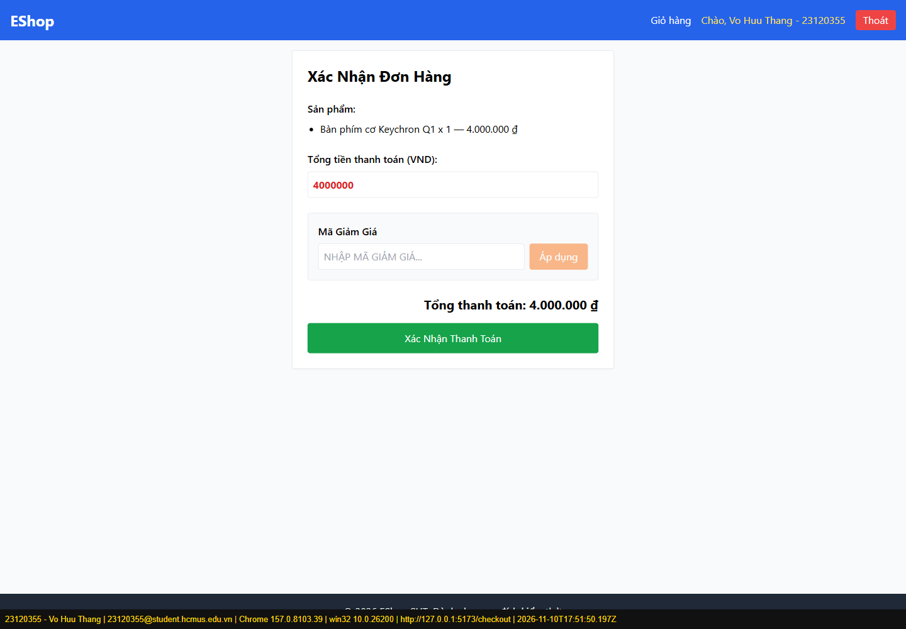

## BUG-03 – Profile từ chối số điện thoại hợp lệ bắt đầu bằng 0

- Cơ sở: eshop-sut/README.md — FR-04
- Severity: Major
- Thực hiện: Đăng nhập; mở Profile; nhập 0912345678; bấm Cập nhật.
- Expected: Số điện thoại hợp lệ được chấp nhận.
- Actual: Hiện alert Số điện thoại không hợp lệ.
- Trạng thái: Reproduced/observed; chưa sửa source SUT.

## BUG-04 – Checkout cho sửa trực tiếp tổng tiền thanh toán

- Cơ sở: eshop-sut/README.md — FR-08
- Severity: Major
- Thực hiện: Thêm bàn phím 4.000.000 ₫; đi qua Cart đến Checkout; gõ 1000 vào tổng tiền.
- Expected: Tổng tiền hiển thị theo giỏ, người dùng không tùy ý sửa.
- Actual: Input nhận 1000, coupon hiện hành bị xóa. Lượt này không gửi thanh toán với giá đã sửa; không khẳng định persistence gian lận đã retest.
- Trạng thái: Reproduced/observed; chưa sửa source SUT.

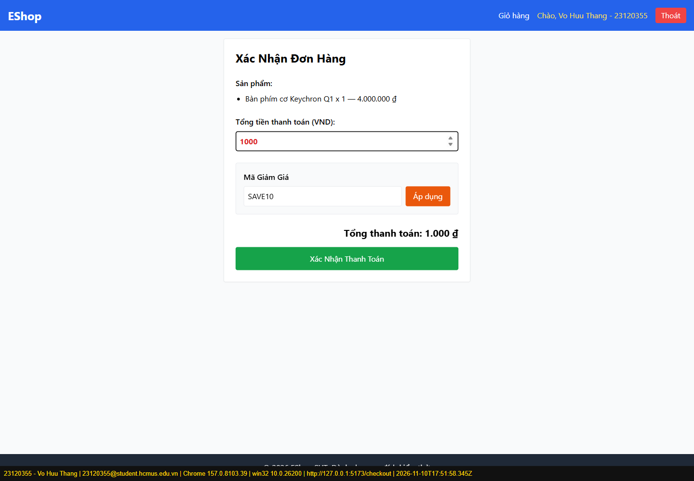

## BUG-05 – Admin lưu sản phẩm có giá 0 hoặc âm

- Cơ sở: eshop-sut/README.md — FR-15
- Severity: Major
- Thực hiện: Đăng nhập Admin; tạo sản phẩm tổng hợp với giá 0, rồi -1000; lưu; đọc lại API products.
- Expected: Giá phải > 0; dữ liệu không hợp lệ bị chặn.
- Actual: Cả 0 và -1000 được lưu thật; fixture được xóa sau test.
- Trạng thái: Reproduced/observed; chưa sửa source SUT.

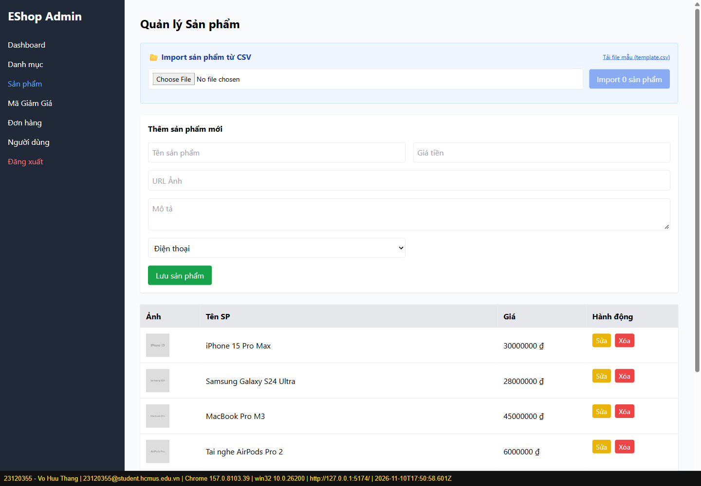

## BUG-06 – Đăng ký native mobile thiếu Xác nhận mật khẩu

- Cơ sở: eshop-sut/README.md — FR-01, FR-20
- Severity: Major
- Thực hiện: Mở đăng ký trên app Android; xem toàn bộ form.
- Expected: Có trường Xác nhận mật khẩu.
- Actual: Chỉ có Họ Tên, Email, Mật khẩu rồi nút Đăng Ký.
- Trạng thái: Reproduced/observed; chưa sửa source SUT.

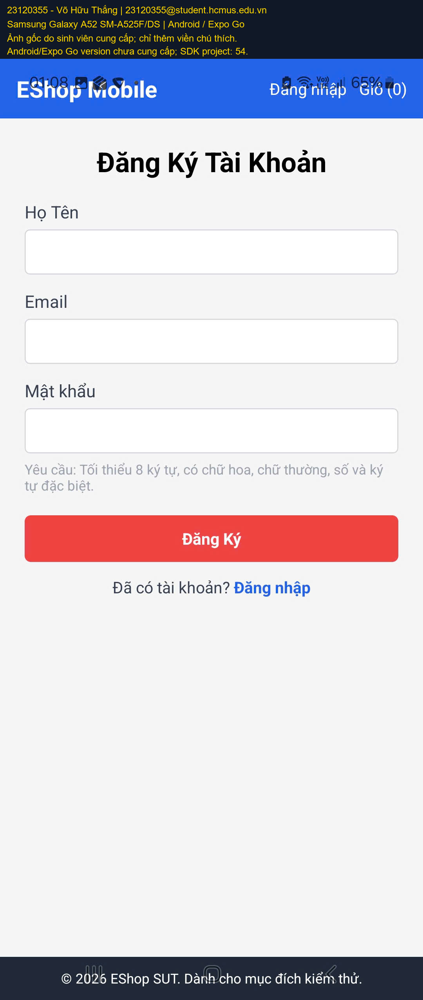

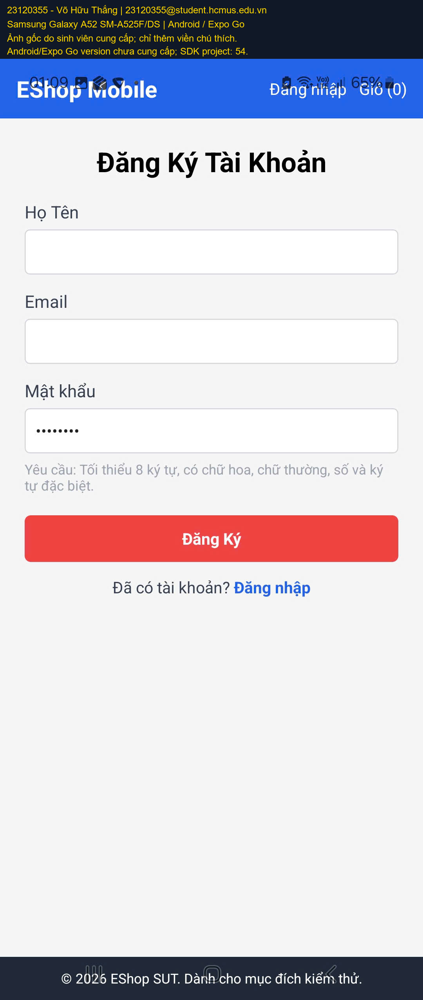

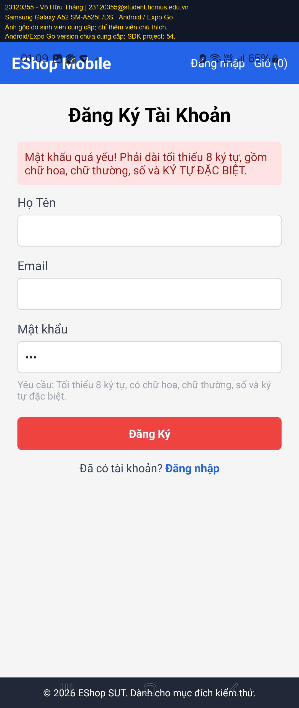

## BUG-07 – Click label Số điện thoại không focus input Profile

- Cơ sở: Checklist IA-02 / liên kết label-control và thao tác form
- Severity: Minor
- Thực hiện: Mở Profile; click nhãn Số điện thoại; kiểm tra activeElement.
- Expected: Label liên kết với ô nhập tương ứng.
- Actual: Input phone không được focus; thiếu liên kết label-control. Chưa kiểm định đầy đủ bằng screen reader.
- Trạng thái: Reproduced/observed; chưa sửa source SUT.

## BUG-08 – Cart không có điều khiển chỉnh số lượng

- Cơ sở: eshop-sut/README.md — FR-07
- Severity: Major
- Thực hiện: Thêm sản phẩm qua UI; mở Cart bằng link trong SPA; xem dòng hàng.
- Expected: Cột số lượng có nút +/- để chỉnh.
- Actual: Số lượng chỉ là text; dòng hàng chỉ có nút Xóa.
- Trạng thái: Reproduced/observed; chưa sửa source SUT.

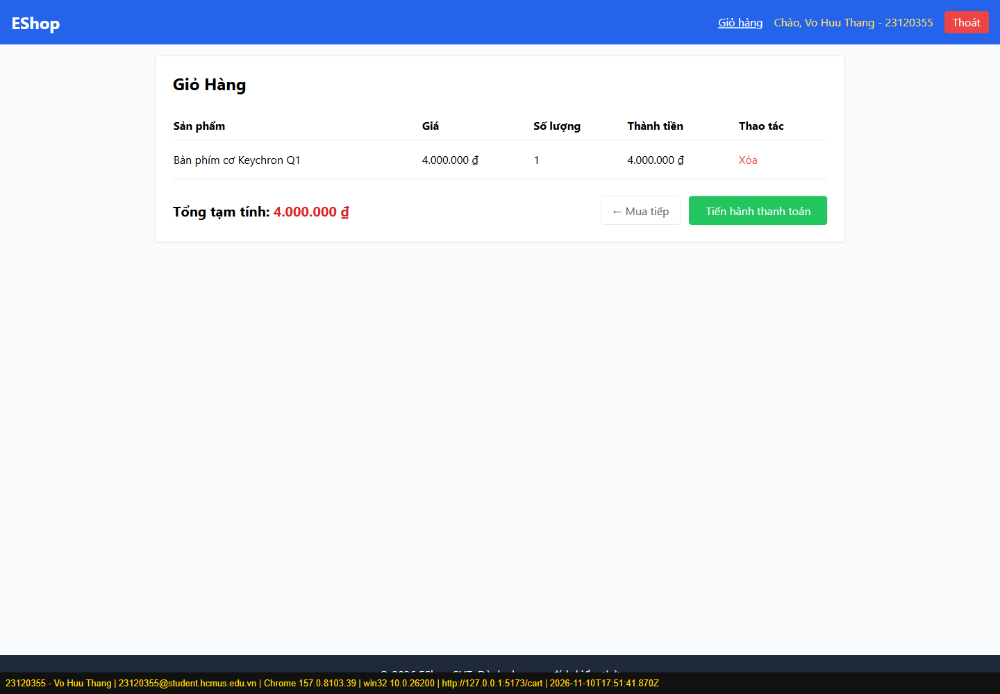

## BUG-09 – Admin nhận và lưu tên sản phẩm dài 256 ký tự

- Cơ sở: eshop-sut/README.md — FR-15
- Severity: Minor
- Thực hiện: Nhập tên H lặp 256 lần và giá 1000; lưu.
- Expected: Tên tối đa 255 ký tự.
- Actual: Input nhận đủ 256 ký tự, POST products HTTP 200.
- Trạng thái: Reproduced/observed; chưa sửa source SUT.

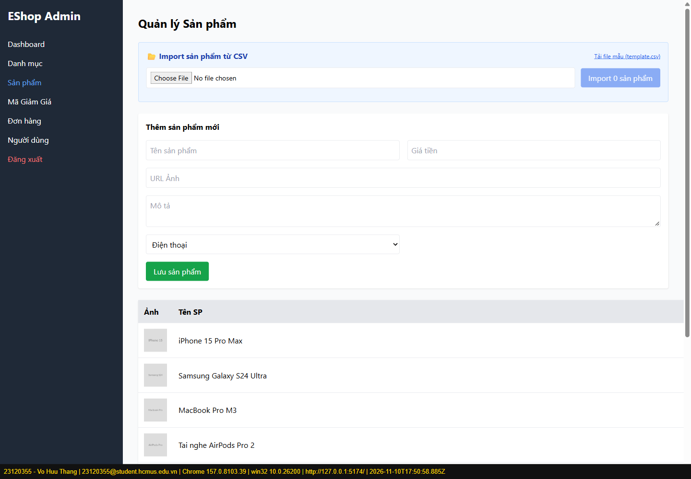

## BUG-10 – Header web không có badge số lượng giỏ hàng

- Cơ sở: eshop-sut/README.md — FR-23
- Severity: Minor
- Thực hiện: Thêm hàng; mở Cart, quan sát header.
- Expected: Link Giỏ hàng có badge đếm.
- Actual: Header chỉ hiển thị chữ Giỏ hàng.
- Trạng thái: Reproduced/observed; chưa sửa source SUT.

## BUG-11 – Header web không đánh dấu trang đang chọn

- Cơ sở: eshop-sut/README.md — FR-23
- Severity: Minor
- Thực hiện: Mở Profile; kiểm tra link hiện tại và ảnh render.
- Expected: Navbar highlight trang đang chọn.
- Actual: Không có aria-current hoặc kiểu active theo route; ảnh Profile không đánh dấu mục hiện tại.
- Trạng thái: Reproduced/observed; chưa sửa source SUT.

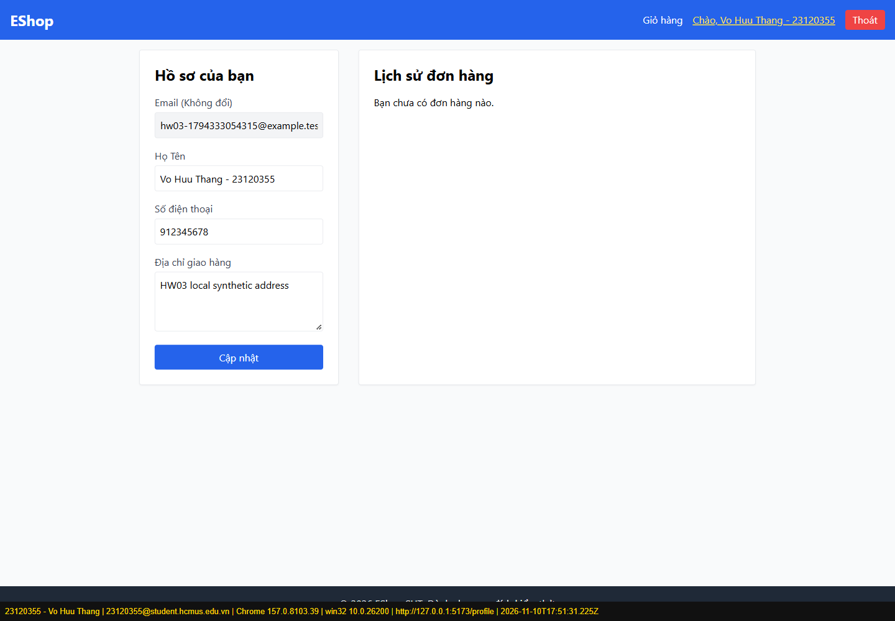

## BUG-13 – Sửa một sản phẩm làm đổi tên toàn bộ bảng Admin trên UI

- Cơ sở: eshop-sut/README.md — FR-15
- Severity: Major
- Thực hiện: Tạo fixture riêng; ở Admin bấm Sửa dòng fixture; đổi tên; bấm Lưu sản phẩm; đối chiếu UI và API.
- Expected: Chỉ sản phẩm được chọn thay đổi.
- Actual: 6/6 dòng UI đổi cùng tên; API chỉ có 1 sản phẩm đổi tên. Không tái hiện lỗi nút Sửa bị đơ; đó từng là lỗi locator harness đã sửa.
- Trạng thái: Reproduced/observed; chưa sửa source SUT.

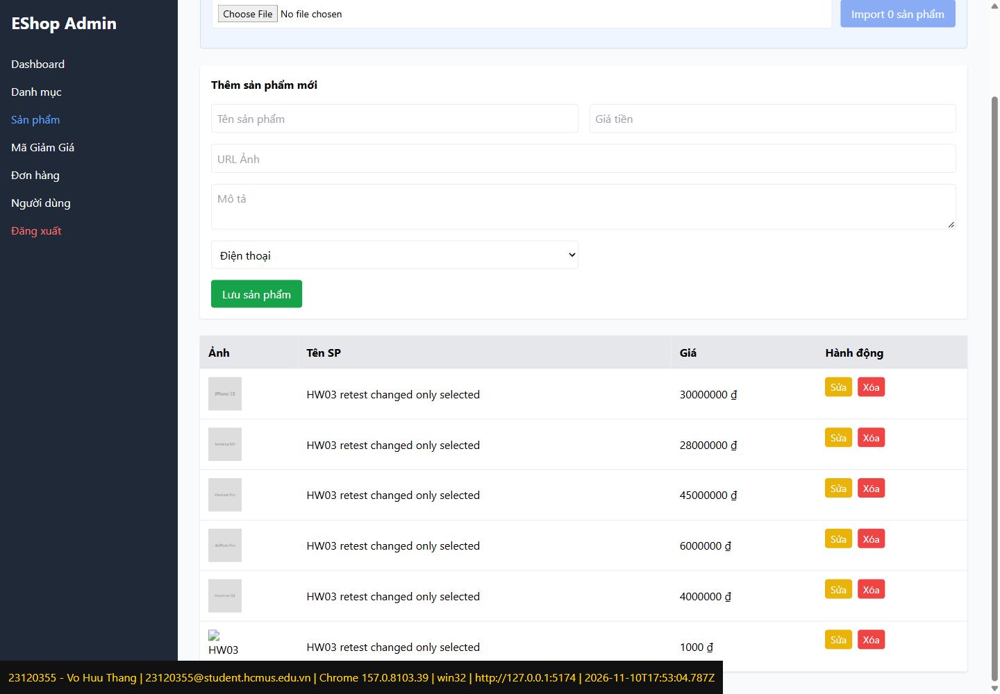

## BUG-14 – Xóa sản phẩm Cart thực hiện ngay, thiếu dialog xác nhận

- Cơ sở: eshop-sut/README.md — FR-07, FR-24
- Severity: Major
- Thực hiện: Cart có một dòng hàng; bấm Xóa; ghi dialog và trạng thái sau.
- Expected: Hỏi xác nhận trước khi xóa.
- Actual: Dòng hàng biến mất và chuyển empty state, không có confirm.
- Trạng thái: Reproduced/observed; chưa sửa source SUT.

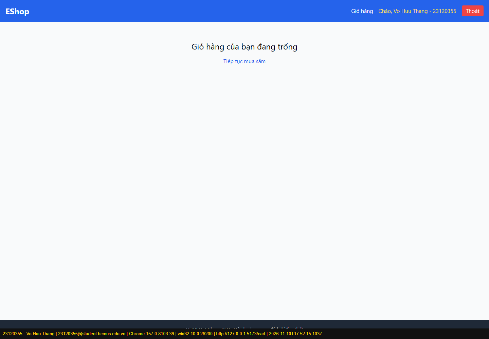

## BUG-16 – ProductDetail bỏ qua lần bấm Thêm vào giỏ đầu tiên

- Cơ sở: eshop-sut/README.md — FR-24
- Severity: Major
- Thực hiện: Mở chi tiết bàn phím; bấm Thêm vào giỏ hàng một lần, quan sát; bấm lần hai.
- Expected: Lần bấm đầu có phản hồi và thêm hàng.
- Actual: Lần đầu chưa có Đã thêm; lần hai có Đã thêm và giỏ nhận sản phẩm.
- Trạng thái: Reproduced/observed; chưa sửa source SUT.

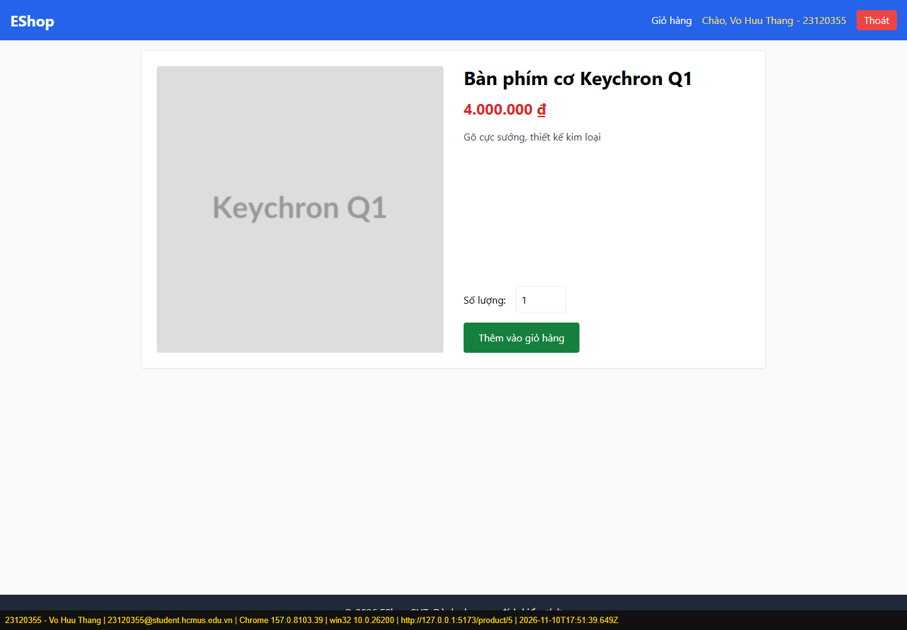

## BUG-17 – Admin chấp nhận tên sản phẩm toàn khoảng trắng

- Cơ sở: eshop-sut/README.md — FR-15
- Severity: Major
- Thực hiện: Thử tên rỗng; sau đó nhập ba dấu cách và giá 1000; lưu, đọc lại API.
- Expected: Tên bắt buộc có nội dung.
- Actual: Tên rỗng bị chặn, nhưng ba dấu cách được POST HTTP 200 và lưu thật.
- Trạng thái: Reproduced/observed; chưa sửa source SUT.

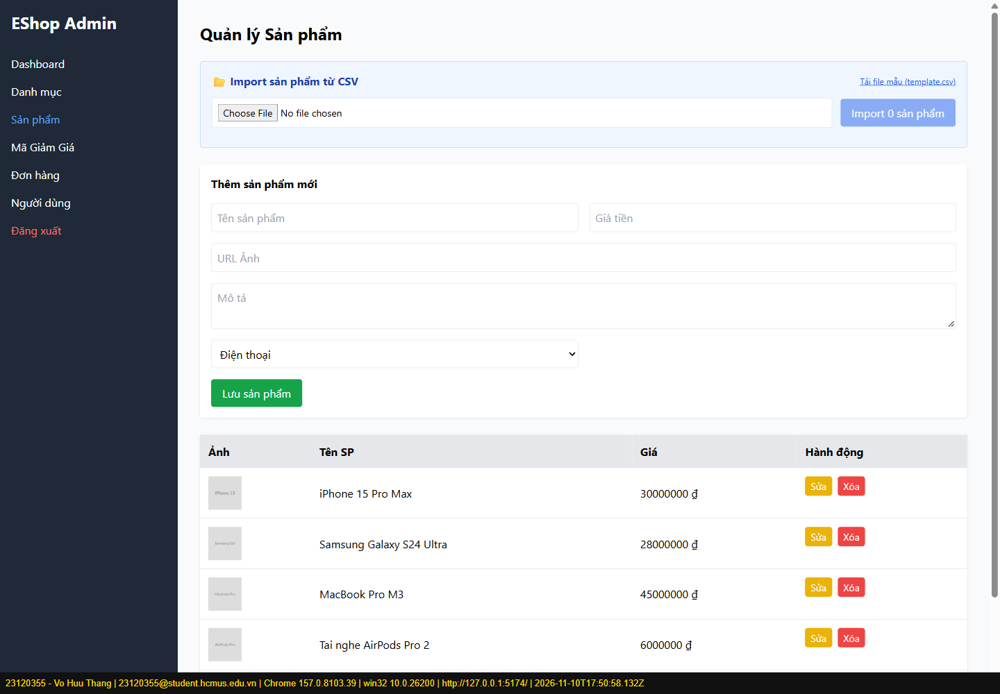

## BUG-18 – Native Android bị status/navigation bar chồng nội dung

- Cơ sở: Checklist IA-01: safe area / nội dung đọc được trên thiết bị thật
- Severity: Major
- Thực hiện: Mở Home và Đăng ký trên Galaxy A52, quan sát header/footer.
- Expected: Nội dung app nằm ngoài vùng hệ thống che phủ.
- Actual: Status bar chồng chữ EShop Mobile/Đăng nhập; navigation bar chồng footer ở đáy.
- Trạng thái: Reproduced/observed; chưa sửa source SUT.

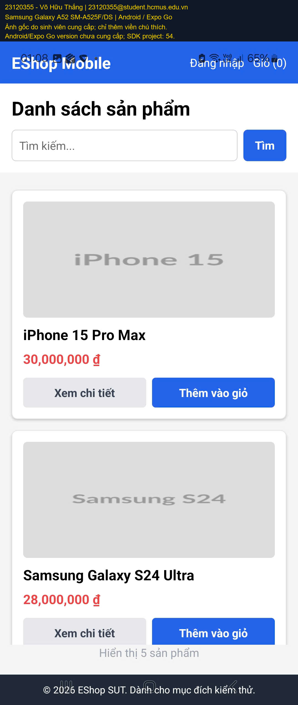

## BUG-19 – Profile không có h1 mô tả trang

- Cơ sở: eshop-sut/README.md — FR-21
- Severity: Minor
- Thực hiện: Mở Profile; đọc headings trong main.
- Expected: Mỗi trang có đúng một h1.
- Actual: Main có hai h2, không có h1. Không còn dùng yêu cầu tự đặt bắt buộc Lịch sử phải là h3.
- Trạng thái: Reproduced/observed; chưa sửa source SUT.

## BUG-22 – SAVE10 trên đơn 4 triệu làm tổng thành 40 triệu

- Cơ sở: eshop-sut/README.md — FR-09
- Severity: Major
- Thực hiện: Tài khoản test mới; thêm bàn phím 4.000.000 ₫; Checkout; nhập SAVE10; bấm Áp dụng.
- Expected: Giảm 400.000 ₫, còn 3.600.000 ₫.
- Actual: UI thông báo giảm 10% nhưng Tiết kiệm -36.000.000 ₫ và tổng 40.000.000 ₫. Chưa gửi đơn với coupon sai này.
- Trạng thái: Reproduced/observed; chưa sửa source SUT.

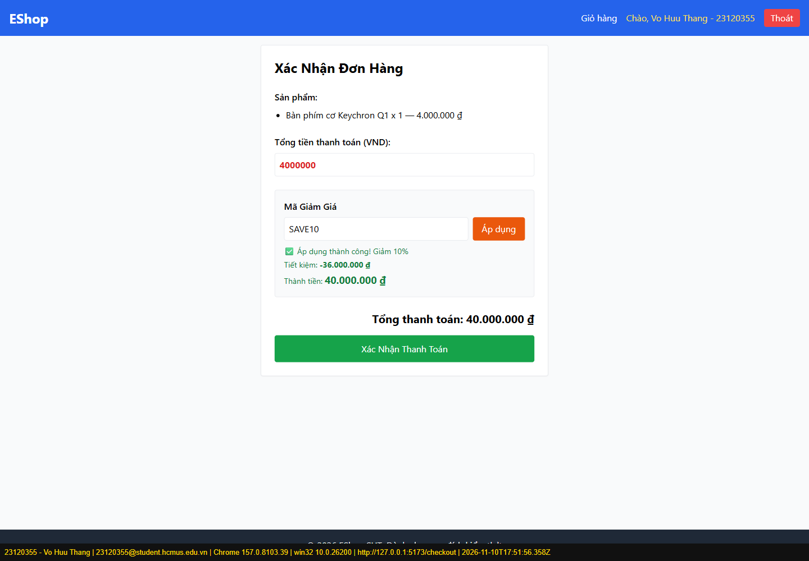

## BUG-23 – Nút xác nhận Checkout màu xanh lá trái quy định xanh dương

- Cơ sở: eshop-sut/README.md — FR-21
- Severity: Minor
- Thực hiện: Checkout có hàng; quan sát nút Xác Nhận Thanh Toán và computed background.
- Expected: Hành động tích cực dùng xanh dương.
- Actual: Computed rgb(22,163,74), ảnh hiển thị xanh lá.
- Trạng thái: Reproduced/observed; chưa sửa source SUT.

## Nhận xét usability / thiết kế

| Mã | Checklist | Nhận xét |
| --- | --- | --- |
| UX-01 | CHK-IA01-02 | Giá căn trái thay vì căn phải theo checklist grid; chưa có ràng buộc căn phải trong SRS. |
| UX-02 | CHK-IA01-08 | Tên 256 ký tự làm bảng rộng hơn vùng chứa; đây là probe ngoài giới hạn tên hợp lệ 255 ký tự, không tách thành bug nghiệp vụ mới. |
| UX-03 | CHK-IA03-04 | Home mobile chưa login không có bottom navigation theo checklist; SRS yêu cầu chức năng nhưng không bắt buộc đặt thanh ở đáy. |
| UX-04 | CHK-IA04-01 | Hủy đơn không có confirm; đây là đề xuất phòng ngừa sai thao tác. FR-24 yêu cầu confirm khi xóa giỏ, không quy định tương tự cho hủy đơn. |
| UX-05 | CHK-IA04-04 | Chưa login được alert rồi chuyển Login đúng. Inline/toast là đề xuất UX, không kết luận lỗi access control. |

## Đính chính lịch sử

- BUG-02 (thiếu alt Admin) bị bác bỏ: lần chạy thật có alt tên sản phẩm và kích thước thumbnail đồng đều. Không sửa số liệu bằng cách tiếp tục giữ bug sai.
- BUG-12 và BUG-15 chuyển thành UX-04 và UX-05; BUG-14 vẫn là bug vì SRS có yêu cầu confirm xóa giỏ.
- Bằng chứng BUG-13 cũ là Login Admin, BUG-08 cũ là giỏ trống: không dùng làm chứng cứ cho kết luận mới.
- Chưa sửa lỗi sản phẩm. Không ghi trạng thái Fixed chỉ vì đã sửa báo cáo.

## Tái kiểm tra Task 3

Các mục web áp dụng được chạy lại trên Chrome và Firefox; kết quả 21 Pass / 19 Fail ở mỗi môi trường. [Ma trận](HW03_Cross_Platform_Report.md) ghi riêng môi trường, nguồn bằng chứng và native scope. Ảnh native trong báo cáo dùng bản có watermark; ảnh gốc vẫn lưu cục bộ. Không có sửa source SUT hoặc thay đổi số lượng 18 bug xác nhận.
