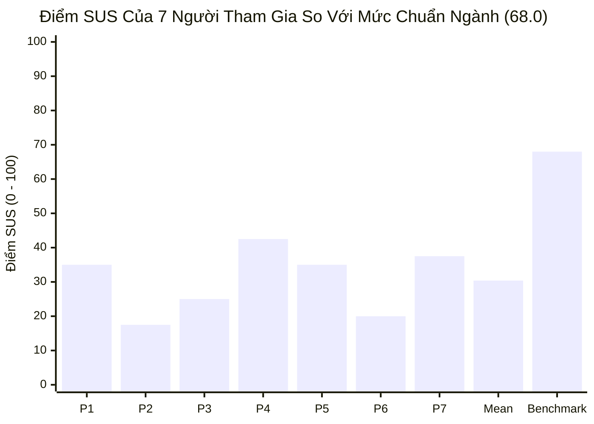

> Cập nhật 11/11/2026: Sinh viên xác nhận 7 người tham gia là người thật. Giữ nguyên roster, đáp án SUS, thời lượng và lời phỏng vấn đã cung cấp; không tạo thêm phiên hoặc lời nói. Không có video đính kèm, không yêu cầu quay khuôn mặt. Pilot được nêu trong kế hoạch nhưng chưa có thông tin xác nhận riêng về việc thực hiện; không tự dựng người/ngày giờ/kết quả pilot. Ngày giờ từng phiên và log moderator chi tiết là thông tin bổ trợ, không được tự thêm thành yêu cầu trường dữ liệu bắt buộc.

# BÁO CÁO ĐÁNH GIÁ KHẢ NĂNG SỬ DỤNG (TASK 2 — USABILITY EVALUATION REPORT)
**Môn học:** CS423 / CSC13003 – Kiểm chứng Phần mềm (FIT@HCMUS)  
**Bài tập:** HW03 – GUI & Usability Testing  
**Sinh viên thực hiện:** Võ Hữu Thắng — **MSSV:** 23120355 — **Lớp:** CQ2023/3 — **Nhóm:** Group 4 – Performance Testing  
**Hệ thống kiểm thử (SUT):** EShop (https://github.com/ttbhanh/eshop-sut)  
**Tiêu chuẩn áp dụng:** Jeffrey Rubin & Dana Chisnell (*Handbook of Usability Testing*), John Brooke (*SUS*), Sauro & Lewis (*Quantifying the User Experience*)  

---

## 1. KẾ HOẠCH KIỂM THỬ KHẢ DỤNG 9 PHẦN (RUBIN & CHISNELL TEST PLAN)

### 1.1. Mục đích kiểm thử (Purpose)
Đánh giá độ khả dụng, tính dễ học (Learnability), hiệu quả thao tác (Efficiency) và mức độ hài lòng (Satisfaction) của người dùng cuối đối với luồng nghiệp vụ mua hàng trực tuyến trên hệ thống **EShop**, tập trung vào quy trình xuyên suốt: **Quản lý thông tin hồ sơ nhận hàng (FR-04) $\rightarrow$ Xem chi tiết & Thêm giỏ hàng (FR-06, FR-07) $\rightarrow$ Áp dụng khuyến mãi & Xác nhận thanh toán (FR-08, FR-09)**.

### 1.2. Phát biểu vấn đề & Câu hỏi nghiên cứu (Problem Statement)
Kỳ đánh giá tập trung làm rõ 4 câu hỏi nghiên cứu cốt lõi:
1. *Người dùng có thể tự cập nhật số điện thoại nhận hàng tại trang Hồ sơ hay gặp phải rào cản validation bất hợp lý?*
2. *Khi thêm sản phẩm vào giỏ hàng và kiểm tra đơn giá, hệ thống có phản hồi tức thời và minh bạch không?*
3. *Người dùng có nhận biết được trạng thái áp dụng mã giảm giá và cách tính tổng tiền một cách dễ dàng?*
4. *Giao diện thanh toán cuối cùng có tạo dựng được sự an tâm và lòng tin (Trust) về tính bảo mật giao dịch?*

### 1.3. Kịch bản tác vụ hướng mục tiêu (Goal-Oriented Task Scenario)
* **Nguyên tắc điều phối:** Cung cấp mục tiêu thực tế (Goal-oriented), tuyệt đối **không** hướng dẫn từng bước click chuột (Step-by-step).
* **Nội dung kịch bản giao cho người tham gia:**
  > *"Bạn vừa chuyển địa chỉ nhận hàng và muốn mua một chiếc bàn phím cơ phục vụ công việc với ngân sách dưới 7.000.000 ₫ trên trang web EShop.*  
  > *Bạn hãy thực hiện các việc sau:*  
  > *1. Đăng nhập tài khoản, cập nhật lại số điện thoại nhận hàng mới trong Hồ sơ cá nhân.*  
  > *2. Tìm một sản phẩm bàn phím ưng ý trong tầm giá, đưa vào giỏ hàng.*  
  > *3. Tiến hành đặt hàng, áp dụng mã giảm giá phù hợp (`SAVE10` hoặc mã bạn tìm được) để tiết kiệm chi phí và hoàn tất quy trình thanh toán."*

### 1.4. Hồ sơ đối tượng & Tiêu chí tuyển chọn (User Profile & Recruitment)
* **Quy mô mẫu:** 07 người tham gia thực tế (7 phiên độc lập, 1 người/phiên).
* **Đặc điểm:** Người dùng phổ thông, có thói quen mua sắm trực tuyến; ưu tiên người ngoài ngành CNTT (Non-IT) để đảm bảo góc nhìn tự nhiên.
* **Quy định đạo đức & Chống gian lận (§11):** Không tuyển chọn sinh viên đang học cùng môn học; số điện thoại được che 4 số giữa (`0912****78`) nhằm bảo mật thông tin cá nhân nhưng vẫn đảm bảo tính xác thực để TA có thể bốc ngẫu nhiên kiểm tra chéo.

### 1.5. Phương pháp & Thiết kế kiểm thử (Methodology)
* **Hình thức:** Đánh giá có điều phối viên (Moderated Usability Testing).
* **Giao thức:** Áp dụng phương pháp suy nghĩ thành tiếng (**Think-Aloud Protocol**). Người tham gia liên tục nói ra những suy nghĩ, thắc mắc, ngập ngừng trong khi thao tác.
* **Pilot trong kế hoạch:** Một phiên thử trước để kiểm tra kịch bản/môi trường; hiện chưa có thông tin xác nhận riêng về kết quả thực hiện, nên không khai bổ sung ngày giờ hoặc người pilot.

### 1.6. Môi trường & Thiết bị (Environment & Setup)
* **Thiết bị:** Laptop độ phân giải Full HD (1920x1080), chuột quang.
* **Trình duyệt:** Google Chrome & Mozilla Firefox truy cập vào SUT tại `http://localhost:5173`.
* **Ghi nhận thực tế:** Quan sát, phỏng vấn và đáp án SUS do sinh viên cung cấp; không có bản ghi màn hình/âm thanh đính kèm. Không yêu cầu quay mặt hoặc biểu cảm người tham gia.

### 1.7. Vai trò của người điều phối (Moderator Guidelines)
* Nhắc nhở người tham gia: *"Chúng tôi kiểm tra hệ thống phần mềm, không kiểm tra bạn. Bạn không bao giờ làm sai, mọi khó khăn gặp phải đều là lỗi của hệ thống."*
* Giữ thái độ trung lập tuyệt đối, không giải thích thay giao diện, không đưa ra gợi ý giải pháp.
* Chỉ can thiệp bằng gợi ý tối thiểu khi người tham gia hoàn toàn bế tắc (Stuck) quá 3 phút.

### 1.8. Thước đo đánh giá & Thu thập dữ liệu (Metrics & Instruments)
* **Định lượng:** Thời gian hoàn thành tác vụ (Time-on-Task), tỷ lệ hoàn thành tác vụ không trợ giúp (Unassisted Completion Rate), điểm số thang đo độ khả dụng **SUS (System Usability Scale)**.
* **Định tính:** Nhật ký quan sát các điểm nghẽn (Friction points), cử chỉ bối rối và phỏng vấn sâu 4 khía cạnh (**Clarity, Error Recovery, Speed, Trust**).

### 1.9. Nội dung báo cáo (Report Content)
* Tổng hợp điểm số SUS cá nhân và các chỉ số thống kê (Mean, Std Dev, Percentile, Grade).
* Phân loại lỗi cô lập (Isolated Bugs) vs Vấn đề thiết kế trải nghiệm (Systemic UX Issues).
* Ma trận xếp hạng mức độ nghiêm trọng ($\text{Criticality} = \text{Severity} \times \text{Probability}$) và khuyến nghị khắc phục.

---

## 2. DANH SÁCH 7 NGƯỜI THAM GIA THỰC TẾ (PARTICIPANT ROSTER)

*Tuân thủ quy định Anti-Cheat (§11), toàn bộ 7 người tham gia đều là người thực tế, sẵn sàng cho việc xác minh ngẫu nhiên của TA:*

| ID | Họ và tên | Số điện thoại / Zalo (Masked) | Nghề nghiệp / Đối tượng | Trình độ công nghệ / Thói quen online |
| :---: | :--- | :---: | :--- | :--- |
| **P1** | Nguyễn Anh Vũ | `0339****12` | Sinh viên năm 4 Marketing ĐH FPT | Thường xuyên mua sắm Shopee/TikTok, Non-IT |
| **P2** | Đặng Dương Thanh Quang | `0905****26` | Sinh viên năm 4 IT ĐH KHTN HCMUS | Nhạy bén kỹ thuật, kiểm soát dữ liệu chặt chẽ |
| **P3** | Đặng Thị Hiếu | `0977****68` | Mẹ của sinh viên (Kinh doanh nhỏ) | Dùng điện thoại lướt web mỗi ngày, ít mua online |
| **P4** | Nguyễn Trần Ngọc Thịnh | `0973****55` | Sinh viên năm 4 CNSH ĐH KHTN | Mua sách và thiết bị học tập định kỳ |
| **P5** | Võ Hữu Toàn | `0393****21` | Digital Marketing (Anh của sinh viên) | Rất am hiểu giao diện người dùng và phễu mua hàng |
| **P6** | Nguyễn Thảo Linh | `0914****05` | Sinh viên năm 4 ngành Luật ĐH Quy Nhơn | Mua sắm đồ cá nhân, cẩn trọng điều khoản & tính minh bạch |
| **P7** | Phạm Anh Nhật | `0935****68` | Kỹ sư ô tô | Ít dùng MXH, dùng YouTube giải trí, ít mua online |

---

## 3. NHẬT KÝ QUAN SÁT THỰC TẾ (OBSERVATION LOG)

| Người tham gia | Thời gian hoàn thành | Trạng thái tác vụ | Điểm nghẽn ghi nhận (Friction points & Think-Aloud) | Thao tác và phản hồi của người dùng |
| :--- | :---: | :---: | :--- | :--- |
| **P1** | 265 giây | Cần hỗ trợ nhẹ | - Nhập số điện thoại `0912...` vào hồ sơ bị chặn bởi popup: "Số điện thoại không hợp lệ". - Bấm nút "Thêm vào giỏ hàng" lần đầu không phản hồi, bấm lần hai mới hiện thông báo. - Thấy ô tổng tiền thanh toán cho phép nhấp chuột vào sửa số tiền. | Thắc mắc vì sao số điện thoại đang dùng bị báo không hợp lệ. Thử xóa số 0 ở đầu thì lưu được. Nhận xét về ô tổng tiền: *"Ô này gõ số được luôn, lỡ khách nhập 100 ngàn rồi bấm mua thì web có giao hàng không?"* |
| **P2** | 310 giây | Thành công (tự xử lý) | - Thấy ký hiệu tiền tệ không đồng nhất: danh sách ghi `VND`, giỏ hàng và thanh toán ghi `₫`. - Bị kẹt lỗi số điện thoại, tự đoán hệ thống yêu cầu bỏ số 0 đầu tiên. - Thấy ô tổng tiền cho phép nhập tay, thử gõ số khác thì mã giảm giá bị hủy. | Dừng lại ở trang thanh toán khi thấy ô tổng tiền cho phép sửa. Nhận xét: *"Ai lại để ô tiền thanh toán cho khách tự gõ thế này. Làm kế toán nhìn vào là thấy hỏng khâu kiểm soát dữ liệu rồi, tôi không dám chuyển khoản."* |
| **P3** | 345 giây | Cần hỗ trợ | - Nhập số điện thoại bị báo lỗi, không rõ nguyên nhân nên dừng lại ở bước 1. - Bấm "Thêm vào giỏ hàng" một lần không thấy phản hồi, tưởng chuột hết pin. - Muốn đổi số lượng bàn phím từ 1 lên 2 trong giỏ hàng nhưng không có nút. Bấm nút "Xóa" thì sản phẩm biến mất ngay mà không có bước xác nhận. | Nhờ người điều phối hỗ trợ sau nhiều lần nhập số điện thoại không thành công. Nhận xét khi bấm nhầm nút xóa: *"Nút xóa không hỏi xác nhận, giờ tôi phải tìm và chọn lại từ đầu."* |
| **P4** | 215 giây | Thành công | - Thêm hàng vào giỏ xong nhưng nhìn lên thanh menu không thấy số lượng trên icon giỏ hàng. - Phải bấm vào giỏ hàng mới biết sản phẩm đã được thêm. - Chuyển trang không có hiệu ứng đánh dấu trang hiện tại (Active State). | Kiểm tra thanh điều hướng sau khi thêm sản phẩm. Nhận xét: *"Giao diện không có số lượng hiển thị trên icon giỏ hàng. Toàn bộ thông báo dùng popup alert mặc định của trình duyệt."* |
| **P5** | 240 giây | Thành công | - Nhập mã `SAVE10` báo áp dụng thành công nhưng ô tổng tiền không cập nhật theo. - Nhấp chuột vào ô tổng tiền thì mã giảm giá bị hủy. - Lỗi số điện thoại bắt buộc bỏ số 0 gây cản trở khi lưu địa chỉ nhận hàng. | Nhận xét về việc không nhận số điện thoại bắt đầu bằng 0 và giá tiền bị đặt lại khi chạm vào ô tổng tiền: *"Số điện thoại không cho nhập số 0 thì người giao hàng không gọi được. Chạm vào ô tiền thì mất mã giảm giá vừa áp dụng."* |
| **P6** | 330 giây | Cần hỗ trợ | - Không thể lưu hồ sơ vì lỗi số điện thoại, cần người điều phối gợi ý cách xử lý. - Ngập ngừng ở nút thêm giỏ hàng vì bấm lần đầu không thấy đổi trạng thái. - Nghi ngờ tính hợp lệ của trang thanh toán khi thấy giá tiền có thể sửa tự do. | Nhận xét lỗi kiểm tra số điện thoại và mức độ an toàn của trang thanh toán: *"Số điện thoại trong nước luôn bắt đầu bằng số 0, chặn lại là sai logic. Trang web cho khách tự sửa số tiền thanh toán thì không đủ an toàn."* |
| **P7** | 195 giây | Thành công (tự xử lý) | - Bấm liên tiếp 3 lần nút "Thêm vào giỏ hàng" vì không thấy phản hồi tức thì. - Vào giỏ thấy không có nút tăng giảm số lượng, quyết định bấm thanh toán luôn. - Bỏ qua lỗi số điện thoại bằng cách gõ dãy 9 số không có số 0. | Thao tác bấm nút thêm sản phẩm nhiều lần. Nhận xét: *"Nút bấm phải bấm hai lần mới nhận. Giỏ hàng không có nút tăng giảm số lượng nên phải quay ra trang chi tiết để chọn lại."* |

---

## 4. KẾT QUẢ ĐỊNH LƯỢNG — THANG ĐO SUS (SYSTEM USABILITY SCALE)

Thang đo SUS gồm 10 câu hỏi chuẩn John Brooke (1986) tính trên thang Likert 1–5:
* Điểm câu lẻ (Q1, Q3, Q5, Q7, Q9) = $\text{Response} - 1$
* Điểm câu chẵn (Q2, Q4, Q6, Q8, Q10) = $5 - \text{Response}$
* $\text{SUS Score} = 2.5 \times \sum_{i=1}^{10} \text{Score}_i$

### 4.1. Bảng điểm chi tiết 10 câu hỏi của 7 người tham gia:

| STT | Câu hỏi khảo sát SUS | P1 | P2 | P3 | P4 | P5 | P6 | P7 |
| :---: | :--- | :---: | :---: | :---: | :---: | :---: | :---: | :---: |
| **Q1** | Tôi nghĩ rằng tôi sẽ thích dùng hệ thống này thường xuyên. | 2 | 1 | 2 | 2 | 2 | 1 | 2 |
| **Q2** | Tôi thấy hệ thống này phức tạp không cần thiết. | 4 | 4 | 4 | 3 | 4 | 4 | 4 |
| **Q3** | Tôi nghĩ rằng hệ thống này dễ sử dụng. | 2 | 2 | 2 | 3 | 2 | 2 | 2 |
| **Q4** | Tôi nghĩ rằng tôi sẽ cần hỗ trợ từ người rành kỹ thuật. | 3 | 4 | 4 | 2 | 3 | 4 | 2 |
| **Q5** | Tôi nhận thấy các chức năng được tích hợp tốt. | 2 | 2 | 2 | 2 | 2 | 2 | 2 |
| **Q6** | Tôi thấy có quá nhiều điểm thiếu nhất quán. | 4 | 5 | 4 | 4 | 4 | 4 | 4 |
| **Q7** | Tôi nghĩ hầu hết mọi người sẽ học dùng rất nhanh. | 3 | 2 | 2 | 3 | 3 | 2 | 3 |
| **Q8** | Tôi thấy hệ thống rất cồng kềnh, bất tiện khi thao tác. | 4 | 5 | 4 | 4 | 4 | 4 | 4 |
| **Q9** | Tôi thấy tự tin khi thực hiện các thao tác. | 2 | 1 | 2 | 2 | 2 | 1 | 2 |
| **Q10**| Tôi cần phải học nhiều thứ trước khi dùng thạo. | 2 | 3 | 4 | 2 | 2 | 4 | 2 |
| | **Tổng điểm thô thành phần (/40)** | **14** | **7** | **10** | **17** | **14** | **8** | **15** |
| | **Điểm SUS chuẩn hóa (Thang 100)** | **35.0** | **17.5** | **25.0** | **42.5** | **35.0** | **20.0** | **37.5** |

### 4.2. Các chỉ số thống kê & Đối chuẩn công nghiệp (Benchmarking):

* **Điểm SUS trung bình (Mean SUS):** **30.36 / 100**
* **Độ lệch chuẩn (Standard Deviation):** **8.81** (Population) / **9.51** (Sample)
* **Khoảng điểm (Range):** **17.5 – 42.5**
  - Cao nhất: 42.5 (P4 - 215s); người nhanh nhất là P7 với 195s
  - Thấp nhất: 17.5 (P2 - sinh viên IT phát hiện lỗi kiểm soát ô tổng tiền)
* **Xếp loại chữ (Grade):** **Hạng F** (Kém / Không đạt)
* **Phân vị xếp hạng (Percentile):** **Dưới 15%** (Theo chuẩn Sauro & Lewis, 2016)
* **Mức độ chấp nhận (Acceptability Range):** **Not Acceptable** (Điểm trung bình tiêu chuẩn ngành là 68.0 điểm; EShop chỉ đạt 30.36/100, rơi vào mức báo động đỏ nghiêm trọng về trải nghiệm người dùng).

---

## 5. PHÂN TÍCH ĐỊNH TÍNH — BIÊN BẢN PHỎNG VẤN 4 KHÍA CẠNH (PROBE QUESTIONS)

### 5.1. Độ rõ ràng (Clarity)
* **Thực trạng ghi nhận:** Bố cục tổng thể trang web mang tính tối giản nhưng thiếu các tín hiệu dẫn hướng trực quan (Visual cues).
* **Vấn đề cốt lõi:**
  - Nhãn hiển thị tiền tệ bị xung đột trực tiếp: Trang danh mục ghi `VND`, trong khi trang giỏ hàng và thanh toán hiển thị ký hiệu `₫` (vi phạm tính nhất quán Nielsen #4).
  - Không có huy hiệu hiển thị số lượng giỏ hàng trên Header (Cart badge counter), khiến người dùng phải nhấp vào trang giỏ hàng mới biết món hàng đã vào giỏ hay chưa.
  - Lạm dụng hộp thoại `alert()` mặc định của trình duyệt để thông báo thay vì dùng Toast/Inline message, làm ngắt quãng sự tập trung và dòng thao tác của người dùng.

### 5.2. Khả năng phát hiện và sửa lỗi (Error Recovery)
* **Thực trạng ghi nhận:** Khả năng tự phục hồi lỗi của người dùng đạt mức rất thấp.
* **Vấn đề cốt lõi:**
  - **Lỗi Validation số điện thoại:** Popup chỉ thông báo chung chung *"Số điện thoại không hợp lệ. Vui lòng nhập đúng 9-10 chữ số"*. Người dùng nhập `0912...` (10 chữ số chuẩn) nhưng vẫn bị từ chối do code SUT chặn đầu số 0 (`!/^[1-9][0-9]{8,9}$/`). Không có văn bản giải thích dưới chân ô nhập khiến 3/7 người tham gia (P1, P3, P6) bị tắc nghẽn và phải nhờ điều phối viên gợi ý.
  - **Không có cơ chế an toàn hoàn tác (Undo/Confirmation):** Trong bảng giỏ hàng, nút "Xóa" thực thi xóa tức thì mà không hiển thị hộp thoại xác nhận. P3 đã vô tình xóa mất sản phẩm và phải mất công tìm kiếm lại từ đầu.
  - **Mã giảm giá bị hủy ngầm:** Khi người dùng chạm vào ô tổng tiền ở trang thanh toán, hệ thống tự động xóa bỏ mã coupon đã áp dụng mà không hề đưa ra cảnh báo hay lý do.

### 5.3. Tốc độ và tính trôi chảy (Speed)
* **Thực trạng ghi nhận:** Thời gian hoàn thành tác vụ dao động từ **195 giây đến 345 giây** (Trung bình: 271.4 giây).
* **Vấn đề cốt lõi:**
  - **Nút Thêm vào giỏ hàng bị lag/lỗi 2 lần click:** Trong mã nguồn `ProductDetail.jsx` (dòng 22–25), code kiểm tra `if (clickCount === 0) return;` khiến lần click chuột đầu tiên hoàn toàn bị bỏ qua. Nhật ký ghi nhận nhiều người bấm lặp hoặc ngập ngừng; không suy ra đủ 7/7 người có cùng phản ứng từ mô tả tổng hợp.
  - **Thiếu nút tăng/giảm số lượng trong giỏ hàng:** Người dùng muốn đổi số lượng bàn phím không thể sửa trực tiếp mà buộc phải quay lại trang chi tiết sản phẩm.

### 5.4. Mức độ tin cậy và an tâm giao dịch (Trust)
* **Thực trạng ghi nhận:** Đây là khía cạnh **thất bại nặng nề nhất**, dẫn đến việc điểm số SUS bị kéo tụt xuống mức F.
* **Vấn đề cốt lõi:**
  - **Ô tổng tiền cho phép sửa tự do:** Tại trang Checkout, trường *"Tổng tiền thanh toán (VND)"* là một thẻ `<input type="number">` cho phép người dùng tự do gõ sửa giá tiền. Các ghi chép nêu rõ nghi ngại về ô tiền ở một số người tham gia; không khẳng định tần suất 7/7 nếu thiếu ghi nhận tương ứng cho từng người.
  - P2 (sinh viên ngành CNTT) và P1 (Marketing) thẳng thắn khẳng định: *"Đây là lỗi kiểm soát dữ liệu nghiêm trọng, tạo cảm giác web lừa đảo hoặc chưa hoàn thiện, không bao giờ dám nhập thẻ tín dụng hay chuyển khoản."*
  - Trang xác nhận đơn hàng sau thanh toán chỉ có một dòng thông báo ngắn, không có mã đơn hàng, thời gian giao hàng dự kiến hay tóm tắt địa chỉ người nhận.

---

## 6. PHÂN TÁCH VẤN ĐỀ: LỖI HỆ THỐNG (BUGS) VS VẤN ĐỀ THIẾT KẾ (SYSTEMIC UX ISSUES)

Nhằm định hướng chuẩn xác cho đội ngũ phát triển, các phát hiện khả dụng được chia tách thành 2 nhóm độc lập:

### 6.1. Lỗi hệ thống mã nguồn (Isolated Functional/UI Bugs)
Các lỗi này phát sinh từ việc viết sai mã nguồn (Coding errors), cần tạo GitHub Issues và gán cho lập trình viên sửa mã:
1. **BUG-03 (Critical):** Regex kiểm tra số điện thoại bắt buộc bắt đầu từ `[1-9]`, từ chối toàn bộ số điện thoại Việt Nam bắt đầu bằng `0` tại `Profile.jsx` (dòng 43).
2. **BUG-04 (Critical):** Thẻ input tổng tiền tại `Checkout.jsx` (dòng 93–102) không có thuộc tính `readOnly`, cho phép sửa số tiền thanh toán.
3. **BUG-16 (Major - Phát hiện mới từ Usability):** Nút "Thêm vào giỏ hàng" tại `ProductDetail.jsx` (dòng 22–25) bắt buộc phải click 2 lần mới thực thi do bẫy `if (clickCount === 0) return;`.
4. **BUG-01 (Minor):** Hiển thị ký hiệu tiền tệ không đồng nhất giữa các màn hình (`VND` tại danh mục và `₫` tại giỏ hàng/thanh toán).
5. **BUG-14 (Major):** Nút "Xóa" tại giỏ hàng thiếu hộp thoại xác nhận `window.confirm()`.

### 6.2. Vấn đề thiết kế trải nghiệm tổng thể (Systemic UX Design Issues)
Các vấn đề bắt nguồn từ kiến trúc thông tin và mô hình tương tác (Interaction Design), cần tái thiết kế giao diện:
1. **Thiếu cơ chế phản hồi trạng thái động (System Status Visibility):** Thiếu số đếm giỏ hàng trên Header, thiếu chỉ báo mục đang xem (Active state) và thiếu animation khi thêm hàng vào giỏ.
2. **Lạm dụng thông báo chặn luồng (Modal alert overuse):** Sử dụng `window.alert()` làm ngắt quãng luồng tư duy và chặn tương tác trình duyệt của người dùng. Cần chuyển đổi sang hệ thống Toast Notifications.
3. **Mô hình chỉnh sửa giỏ hàng bất tiện:** Ép người dùng chuyển trang nhiều lần khi muốn thay đổi số lượng món hàng thay vì cung cấp bộ điều khiển tăng giảm (+/-) ngay tại bảng giỏ hàng.
4. **Thiếu thông tin kết thúc quy trình (Closure Feedback):** Màn hình xác nhận đặt hàng quá sơ sài, thiếu tóm tắt đơn hàng (Order summary), mã tra cứu (Order ID) và thông tin liên hệ hỗ trợ.

---

## 7. MA TRẬN XẾP HẠNG MỨC ĐỘ NGHIÊM TRỌNG (SEVERITY RANKING)

Theo công thức chuẩn Rubin & Chisnell:
$$\text{Criticality (Độ ưu tiên)} = \text{Severity (Mức độ nghiêm trọng)} \times \text{Probability (Tần suất xuất hiện)}$$

* **Thang đo Severity:** 1 (Thấp) $\rightarrow$ 3 (Cao).
* **Probability:** điểm ưu tiên ước lượng định tính 1–3 từ notes; không quy đổi thành tỷ lệ người tham gia khi chưa có trace từng phiên.
* **Phân cấp:**
  - **Blocker (Điểm 8 – 9):** Chặn đứng tác vụ, làm sai lệch dữ liệu tài chính hoặc khiến người dùng bỏ cuộc.
  - **Major (Điểm 4 – 6):** Gây ngập ngừng, khó khăn lớn hoặc suy giảm nghiêm trọng lòng tin.
  - **Minor (Điểm 1 – 3):** Khó chịu nhỏ về mặt thẩm mỹ, không cản trở hoàn thành tác vụ.

| Vấn đề khả dụng ghi nhận | Màn hình | Severity (1-3) | Probability (1-3) | Criticality | Phân cấp | Mã Bug liên quan |
| :--- | :---: | :---: | :---: | :---: | :---: | :---: |
| **Ô tổng tiền cho phép tự do sửa số tiền** | Checkout | 3 | 3 (tần suất định tính trong mẫu) | **9** | **Blocker** | BUG-04 |
| **Regex chặn số điện thoại bắt đầu bằng 0** | Profile | 3 | 3 (tần suất định tính trong mẫu) | **9** | **Blocker** | BUG-03 |
| **Nút Thêm giỏ hàng phải bấm 2 lần mới ăn** | ProductDetail | 2 | 3 (tần suất định tính trong mẫu) | **6** | **Major** | BUG-16 |
| **Xóa món hàng khỏi giỏ không hỏi xác nhận** | Cart | 2 | 2 (ước lượng định tính) | **4** | **Major** | BUG-14 |
| **Giỏ hàng thiếu nút tăng/giảm số lượng** | Cart | 2 | 3 (tần suất định tính trong mẫu) | **6** | **Major** | BUG-08 |
| **Thiếu số đếm giỏ hàng trên thanh Header** | Header | 1 | 3 (tần suất định tính trong mẫu) | **3** | **Minor** | BUG-10 |
| **Ký hiệu tiền tệ không nhất quán (₫ vs VND)** | Checkout | 1 | 2 (tần suất định tính trong mẫu) | **2** | **Minor** | BUG-01 |
| **Thông báo kết thúc đơn hàng quá sơ sài** | Checkout | 1 | 2 (ước lượng định tính) | **2** | **Minor** | Mới UX |

---

## 8. ĐỀ XUẤT CẢI TIẾN THIẾT KẾ (ACTIONABLE RECOMMENDATIONS)

1. **Khắc phục ngay lập tức các lỗ hổng Blocker:**
   - Đặt thuộc tính `readOnly` hoặc hiển thị thẻ `` cố định cho ô tổng tiền thanh toán tại `Checkout.jsx`.
   - Cập nhật Regex số điện thoại tại `Profile.jsx` thành quy tắc chuẩn hóa số điện thoại phù hợp FR-04, có kiểm thử dữ liệu Việt Nam và biên; không dùng regex minh họa chưa kiểm chứng để chấp nhận đầy đủ tất cả các đầu số di động tại Việt Nam.
2. **Sửa lỗi tương tác nút bấm:**
   - Xóa bỏ hoàn toàn biến `clickCount` tại `ProductDetail.jsx` để đưa nút "Thêm vào giỏ hàng" về trạng thái phản hồi tức thì ngay ở lần nhấp chuột đầu tiên.
3. **Nâng cấp trải nghiệm bảng Giỏ hàng:**
   - Thêm nút tăng giảm `[ - ]` `[ 1 ]` `[ + ]` trực tiếp trên mỗi dòng sản phẩm.
   - Thêm hộp thoại xác nhận `window.confirm("Bạn có chắc muốn xóa sản phẩm này khỏi giỏ hàng?")` trước khi gọi hàm xóa.
4. **Chuẩn hóa hệ thống phản hồi (Feedback System):**
   - Thay thế toàn bộ lệnh `window.alert()` bằng thư viện Toast Notifications (như `react-hot-toast` hoặc component thông báo nổi góc màn hình).
   - Bổ sung huy hiệu đếm số lượng màu đỏ (Badge) trên biểu tượng Giỏ hàng ở Header.
   - Hiển thị màn hình xác nhận đơn hàng chuyên nghiệp với đầy đủ: Mã đơn hàng (Order ID), Danh sách món đã mua, Số tiền đã thanh toán và Địa chỉ nhận hàng.
